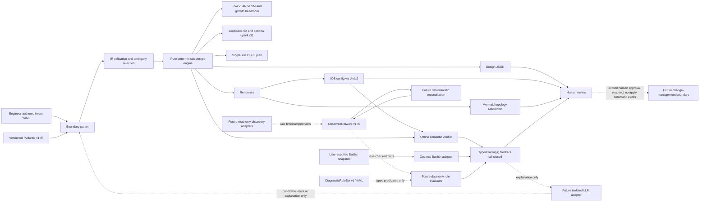

# System architecture

NetOps is a deterministic compiler pipeline. The validated intent is the contract between layers; the language model is not part of the current runtime implementation and has no authority over design, verification, or deployment.

## Layer responsibilities

| Layer | Owns | Current implementation |
| --- | --- | --- |
| IR (`src/netops/ir/v1`) | Versioned declarative input schema and validation | Pydantic models; IDs and subnets are not accepted from intent |
| Observed IR (`src/netops/ir/v1/observed.py`) | Timestamped observed facts, source references, and inferred-link confidence | v1 data contract only; collection and reconciliation are not implemented |
| Finding IR (`src/netops/ir/v1/findings.py`) | Shared versioned result shape | Used by offline IOS checks and Batfish adapter; supports provenance/freshness metadata |
| Diagnostic rules (`src/netops/ir/v1/diagnostics.py`) | Data-only signature, evidence, and predicate contracts | YAML validation only; no diagnosis evaluator or device actions |
| Design (`src/netops/design`) | Deterministic allocation and planned facts | IPv4 VLAN blocks with headroom, stable VLAN IDs, `/32` router ID, optional `/31` uplinks |
| Render (`src/netops/render`, `src/netops/templates`) | Text output from the design | IOS VLAN/SVI, DHCP, loopback, uplink, and OSPF config; Mermaid topology Markdown |
| Verify (`src/netops/verify.py`) | Offline checks with structured findings | Fail-closed checks for the generated IOS subset |
| Optional provider (`src/netops/verify_batfish.py`) | Batfish answer conversion | `undefinedReferences` only; requires optional PyBatfish and a running service |
| CLI (`src/netops/cli.py`) | Paths, flags, files, exit codes, presentation | `design`, `verify`, `verify-batfish`, and `schema` commands |

## Trust and authority boundaries

- Intent YAML is user-controlled input and is rejected if invalid or underspecified for the implemented model.
- Design functions are synchronous and deterministic. They do not access files, devices, networks, or an LLM.
- Templates consume the design result; they do not make design decisions.
- Offline verification covers only implemented IOS syntax and semantics. It is not proof of device behavior or production readiness.
- The Batfish command is opt-in. Failure to import/connect/query fails as a blocker; it cannot silently turn an unavailable check into a pass.
- No device credentials, live configuration access, or apply/deploy command exists in this phase.
- The future LLM edge is intentionally absent today. If added, it may suggest schema-valid intent or explain findings; the deterministic core remains the authority.
- `ObservedNetwork.freshness.max_age_seconds` is policy data, not an automatic staleness check. Any future consumer must compare fact timestamps against its clock and fail/warn according to policy before making joins or diagnoses.
- Diagnostic rule predicates are constrained data, not executable expressions. The current CLI validates rules but does not run them or propose configuration changes.

## Scope boundary

This is a single-campus, IOS-focused phase-one implementation. IPv6, multi-site routing, BGP, ACL policy, CIS scoring, full Batfish analysis, lab emulation, signed change plans, human approval workflow, and deployment are future work. The topology diagram shows planned design facts—not discovered devices, live links, or telemetry.
