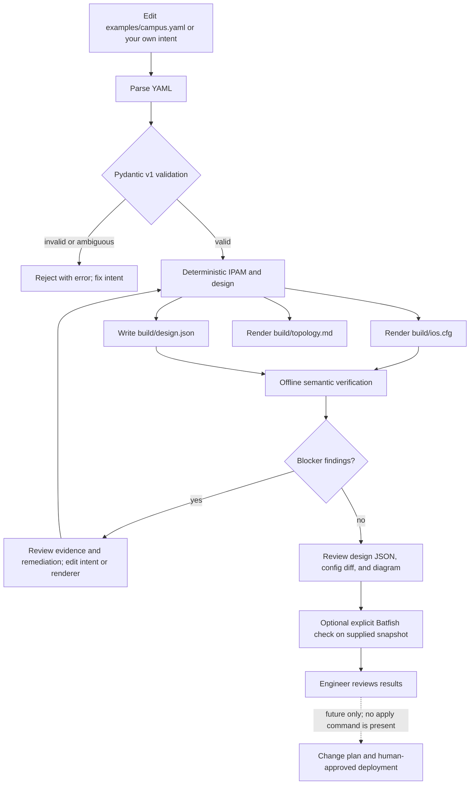

# Build, test, and visualize the workflow

The normal workflow starts from YAML and works entirely offline. The CLI does not call an LLM and does not deploy configuration.



## Run the checks

From the repository root in PowerShell:

```powershell
uv sync --extra dev
uv run pytest
uv run ruff check .
uv run mypy
uv run netops design examples/campus.yaml --output build
uv run netops verify examples/campus.yaml build/ios.cfg
```

A successful offline verification means only that the generated text passed the checks implemented for this IOS subset. It does not establish that a router accepts the configuration, that an adjacency forms, or that a production change is safe.

## View the generated topology

After `netops design`, open `build/topology.md` in VS Code and choose **Markdown: Open Preview** (`Ctrl+Shift+V`) or **Markdown: Open Preview to the Side** (`Ctrl+K`, then `V`). GitHub also renders the Mermaid diagram when the Markdown file is committed. The Markdown contains the generated diagram source, so it can be reviewed without a network service or sharing the intent externally.

The diagram includes the planned site/router ID, VLAN IDs, subnets, gateways, headroom, and optional `/31` uplinks. It deliberately labels the peer as a planned endpoint; it does not assert live connectivity.

## Inspect other inputs and outputs

- **Input:** [`examples/campus.yaml`](../examples/campus.yaml) is a small sample. Copy it before experimenting.
- **Schema:** `uv run netops schema` prints the Pydantic-generated v1 JSON Schema; add `--output schemas/netops-ir-v1.schema.json` to refresh the checked-in schema.
- **Design facts:** `build/design.json` records assigned IDs, prefixes, router IDs, and point-to-point addresses.
- **Rendered config:** `build/ios.cfg` is generated text for review, not a device-ready deployment promise.
- **Verification:** `netops verify` prints rule IDs, severity, evidence, and remediation. Blockers return a nonzero exit code.
- **Optional Batfish:** install `uv sync --extra dev --extra batfish`, start a compatible Batfish service, and run `uv run netops verify-batfish --network <network-name> <snapshot-directory>`. Only `undefinedReferences` is currently queried; failures fail closed.

The current topology view is static output from the design. A visual diff, test-result dashboard, config parser/round-trip view, and live lab topology are not implemented.
